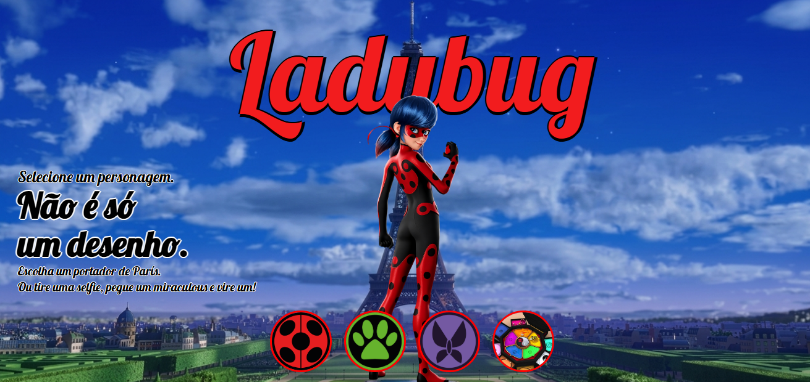

# MLB: Virando Herói!

Um projeto web interativo inspirado no universo de *Miraculous: As Aventuras de Ladybug*, desenvolvido para praticar conceitos de desenvolvimento web e explorar a integração com inteligência artificial para geração de imagens.

## Sobre o projeto

O **MLB: Virando Herói!** permite que o usuário explore personagens do universo de Miraculous e experimente uma transformação personalizada com inteligência artificial.

Além de alternar entre personagens, o usuário pode enviar uma foto própria e gerar uma versão heroica inspirada no universo da animação, com um traje baseado em um dos Miraculous.

O projeto surgiu durante meus estudos com o curso gratuito *Aprendendo Programação com IA do Zero*, do DevClub. A proposta utilizada no curso tinha GTA como tema, e decidi adaptar a ideia para Miraculous, desenvolvendo uma identidade visual própria.

## Funcionalidades

- **Seleção de personagens:** alternância entre Ladybug, Chat Noir e Chrysalis.
- **Transformação com inteligência artificial:** envio de uma foto para gerar uma versão heroica personalizada.
- **Geração de imagens:** criação de um personagem inspirado no universo de Miraculous a partir da imagem enviada.
- **Indicador de carregamento:** feedback visual durante o processamento da transformação.
- **Interface responsiva:** adaptação do layout para diferentes tamanhos de tela.
- **Elementos interativos:** efeitos visuais e interação com os personagens disponíveis.

## Tecnologias utilizadas

- **HTML5:** estrutura e organização do conteúdo.
- **CSS3:** estilização, animações e responsividade.
- **JavaScript:** interatividade, manipulação do DOM, leitura de arquivos e controle do fluxo de geração de imagens.
- **Puter.js:** integração com os recursos de inteligência artificial para geração de imagens.
- **Google Fonts:** utilização da fonte Lobster.

## Como executar o projeto

### Pré-requisitos

- Visual Studio Code.
- Navegador atualizado.
- Extensão Live Server para facilitar a execução local.
- Acesso ao Puter.js e autenticação necessária para utilizar o recurso de geração de imagens.

### Passo a passo

1. Clone o repositório:

   ```bash
   git clone https://github.com/gguiallex/Miraculous-LadingPage
   ```

2. Entre na pasta do projeto:

   ```bash
   cd Miraculous
   ```

3. Abra a pasta no Visual Studio Code.

4. Confira se a estrutura de arquivos e a pasta `imgs/` estão preservadas.

5. Abra o arquivo `index.html` com a extensão Live Server.

6. No navegador, selecione um personagem ou envie uma foto para experimentar a transformação com IA.

**Observação:** a geração de imagens depende da disponibilidade do serviço externo, da autenticação e das condições de uso da plataforma.

## Estrutura do projeto

```text
Miraculous/
├── index.html
├── styles.css
├── Scripts.js
├── README.md
└── imgs/
    ├── paris.jpg
    ├── ladybug.png
    ├── chat_noir.png
    ├── Chrysalis.png
    ├── logo_joaninha.jpg
    ├── logo_gato_preto.jpg
    ├── logo_borboleta.jpg
    └── caixa.jpg
```

## Aprendizados

Durante o desenvolvimento, pratiquei conceitos importantes de desenvolvimento web, como:

- Estruturação de páginas com HTML.
- Estilização e criação de layouts responsivos com CSS.
- Manipulação de elementos da página com JavaScript.
- Leitura de imagens enviadas pelo usuário.
- Uso de operações assíncronas para aguardar a geração de imagens.
- Integração com um serviço externo de inteligência artificial.
- Criação de feedback visual para melhorar a experiência do usuário.

## Créditos

Projeto desenvolvido para fins de aprendizado, com conhecimentos adquiridos durante meus estudos e inspiração no curso gratuito *Aprendendo Programação com IA do Zero*, do DevClub. A proposta foi adaptada para o universo de Miraculous.

*Miraculous: As Aventuras de Ladybug* e seus personagens pertencem aos respectivos detentores de seus direitos. Este é um projeto independente, sem vínculo oficial com a franquia.

---

Desenvolvido como parte da minha jornada de aprendizado em desenvolvimento web.